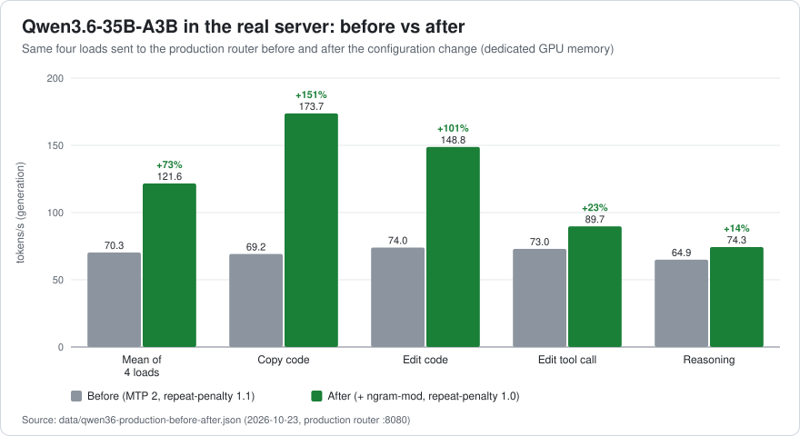

# Qwen3.6 & Qwen3.8 on llama.cpp — faster local inference with MTP + n-gram speculative decoding, prompt-cache tuning and thinking budgets

**English** · [Español](README.es.md)

[](https://github.com/joanmedina/qwen3-llama-cpp-inference-tuning/actions/workflows/check.yml) · MIT licence · llama.cpp build 11721 · measured 2026-10

> A reproducible, measured tuning guide for running **Qwen3.6-35B-A3B** and **Qwen3.8-27B** (hybrid Gated DeltaNet models) with **llama.cpp / `llama-server`** on an **AMD Ryzen AI Max+ 395 "Strix Halo"** mini PC (Radeon 8060S iGPU, Vulkan, 128 GB unified memory). Configurations, step-by-step recipes, benchmarks, raw numbers, figures and scripts — in English and Spanish.



## TL;DR — what changed and by how much

| Area | Before | After | How |
|---|---|---|---|
| **Qwen3.6-35B-A3B generation** (mix of agent loads, production server) | 70.3 tok/s | **121.6 tok/s (+73 %)** — copy ×2.5, edit ×2.0, reasoning +14 % | `--spec-type draft-mtp,ngram-mod --spec-draft-n-max 2 --repeat-penalty 1.0` |
| **Qwen3.8-27B generation** (dense, temporary router) | 12.6 tok/s | **56.9–60.6 tok/s (×4.5–4.8)**; 107 tok/s when copying (×8.5) | MTP head alone gives 26.7; `ngram-mod` on top |
| **Return to a long chat** after another request took the slot (Qwen3.8, 65K tokens) | full re-processing, **> 5 min** | **13.6 s** | `--cache-ram 8192 --ctx-checkpoints 8` (the `4096`/32 it started with cannot even save the chat) |
| **Agent context compaction** (summary over 126K tokens, Qwen3.6) | **313 s** with 4 checkpoints | **14.7 s** with ≥ 8 | keep `--ctx-checkpoints ≥ 8` |
| **Context window** | client believed 262,144, server slot had 131,072 → "Output token limit reached" | client and server agree; 262,144-token window on one slot with q8_0 KV | declare the real per-slot context |
| **Thinking control** | "Off" sent nothing; "High" on Qwen3.8 → HTTP 500; every new chat waited ~23 s for a hidden title request | true Off; `high → xhigh`; title request **22.8 s → 0.5 s**; **Medium matches High's accuracy on hard problems in 73 % of the time** | map the client's levels to what the chat template understands |

All numbers come from [`data/`](data/), were measured on one machine ([hardware](docs/en/01-hardware-and-software.md)), and carry their setup. Absolute speeds are specific to that machine; **relative** effects are what should transfer. Read the [limitations](docs/en/08-limitations.md) before quoting a number.

## The recipe in 30 seconds

```bash
llama-server -m Qwen_Qwen3.6-35B-A3B-Q4_K_M.gguf \
  --spec-type draft-mtp,ngram-mod --spec-draft-n-max 2 --repeat-penalty 1.0 \
  -c 262144 -np 1 -ctk q8_0 -ctv q8_0 -fa on -ngl 999 \
  -cram 8192 -ctxcp 32 -b 2048 -ub 1024 \
  --jinja --reasoning-format deepseek --reasoning-budget 8192
```

| Options | What they do | Evidence |
|---|---|---|
| `--spec-type draft-mtp,ngram-mod --spec-draft-n-max 2` | the model's own MTP head drafts 2 tokens; an n-gram lookup drafts long spans whenever the output repeats the context | [doc 03](docs/en/03-speculative-decoding.md) |
| `--repeat-penalty 1.0` | stops fighting both the n-gram drafts and copying (the model cards recommend it) | [doc 03 §5](docs/en/03-speculative-decoding.md) |
| `-c 262144 -np 1 -ctk q8_0 -ctv q8_0` | the whole native window in one slot, half the KV memory at the same speed | [doc 04 §6, §8](docs/en/04-prompt-cache-context-compaction.md) |
| `-cram 8192 -ctxcp 32` (Qwen3.8: `-ctxcp 8`) | RAM prompt cache and context checkpoints sized for hybrid models | [doc 04 §3–5](docs/en/04-prompt-cache-context-compaction.md) |
| `-b 2048 -ub 1024` | `ubatch 2048` is 23–28 % *slower* at prefill on this machine | [doc 04 §8](docs/en/04-prompt-cache-context-compaction.md) |
| `--reasoning-budget 8192` | server-wide cap on thinking; clients lower it per request with `thinking_budget_tokens` | [doc 05](docs/en/05-thinking-budgets.md) |

The complete, commented configurations are in [`configs/`](configs/); the reason and the evidence for **each** option are in [docs/en/06-recipes.md](docs/en/06-recipes.md).

## Why it works (in three sentences)

On a bandwidth-bound machine, generation speed is roughly *memory bandwidth ÷ bytes of active weights read per pass*, times the tokens produced per pass, so the lever is producing **more than one token per pass**: the model's own **multi-token-prediction head** drafts 2 tokens and an **n-gram lookup** drafts long spans whenever the output repeats text already in the context — which is exactly what a coding agent does when it copies and edits files. Both models are **hybrids** whose recurrent state cannot be rewound, so returning to a long chat or compacting it is cheap only if a **context checkpoint** and the **RAM prompt cache** were sized to the model. And a "thinking level" selector controls nothing unless the client sends what the **chat template** actually reads.

## Contents

| | |
|---|---|
| [01 · Hardware and software](docs/en/01-hardware-and-software.md) | the machine, driver, llama.cpp build, router mode, the two models and why they are hybrids |
| [02 · Methodology](docs/en/02-methodology.md) | one factor at a time on a copy of production, workloads, seeds, noise band, confounders, decision rule |
| [03 · Speculative decoding](docs/en/03-speculative-decoding.md) | MTP draft length, `ngram-mod`, `repeat-penalty`, production result, Qwen3.8, a cross-check without MTP |
| [04 · Prompt cache, context and compaction](docs/en/04-prompt-cache-context-compaction.md) | checkpoints, `--cache-ram`, sizing formula, compaction, the context window the client believes, batch sizes |
| [05 · Thinking budgets and levels](docs/en/05-thinking-budgets.md) | the controls that exist, what a harness really sent, accuracy vs time, the hidden title request |
| [06 · Recipes](docs/en/06-recipes.md) | step-by-step configuration of both models, line by line, and how to apply a change safely |
| [07 · Pitfalls and negative results](docs/en/07-pitfalls-and-negative-results.md) | what was tried and not adopted, silent failures, measurement traps |
| [08 · Limitations](docs/en/08-limitations.md) | threats to validity and what was never measured |
| [09 · Reproducing](docs/en/09-reproducing.md) | measure the same effects on your hardware |
| [References](docs/en/references.md) | papers, software and model cards |

Everything is available in Spanish under [`docs/es/`](docs/es/).

## Quick start

```bash
git clone https://github.com/joanmedina/qwen3-llama-cpp-inference-tuning.git
cd qwen3-llama-cpp-inference-tuning

node tools/gguf-header.mjs /models/Qwen_Qwen3.6-35B-A3B-Q4_K_M.gguf   # does the GGUF ship the MTP head? (look for `nextn` tensors)
cp configs/llama-server/models.example.ini models.ini                   # adapt paths and device names
llama-server --models-preset models.ini --models-max 3 --host 127.0.0.1 --port 8080 --api-key change-me

node bench/spec-bench.mjs  --url http://127.0.0.1:8080 --model qwen3.6 --api-key change-me   # tok/s and draft acceptance per workload
node bench/cache-bench.mjs --url http://127.0.0.1:8080 --model qwen3.6 --api-key change-me   # return-to-chat and compaction scenario
node bench/thinking-check.mjs --url http://127.0.0.1:8080 --model qwen3.6 --api-key change-me # what the thinking controls do
```

Requirements: Node.js ≥ 20 (no packages) and a `llama-server` that knows the options used here (build **11721** was used). Details and expected output: [docs/en/09-reproducing.md](docs/en/09-reproducing.md).

## Repository map

```
docs/en, docs/es     the report, in both languages (nine chapters + references)
configs/             llama-server presets and launch scripts, chat-template patch, client settings (OpenCode, LiteLLM, agent harness)
bench/               spec-bench.mjs (generation speed, acceptance, prompt speed) · cache-bench.mjs (prompt cache and compaction) · thinking-check.mjs (thinking controls)
tools/               gguf-header.mjs (is the MTP head there?) · log-requests.mjs (what does my client send?) · check-links.mjs
data/                every measured number, as JSON with its setup and provenance
figures/             SVG charts in English and Spanish, generated from data/ by make-figures.mjs
```

## Highlights worth knowing before you start

- **Check that your GGUF ships the MTP head** (`node tools/gguf-header.mjs`). Some re-quantised or "abliterated" files drop it, and `draft-mtp` then does nothing.
- **Do not raise `--spec-draft-n-max` above 2 on the MoE model**: going to 4 gains 7 % on copying but loses 11–21 % on prose, agent steps and reasoning, which is where the real traffic is (3 sits in between).
- **`repeat-penalty 1.0`** (what the model cards recommend) is worth +9 % on its own and +27 % when rewriting text with n-gram speculation.
- **A second GPU made it slower** (−20 % generation, Vulkan + CUDA split 80:20) on this unified-memory machine.
- **Keep the resident set inside the GPU-dedicated memory**: the same configuration ran ~15 % slower when the model seemed to land in shared memory (an inference from the situation, not a profiled fact — [doc 01 §4](docs/en/01-hardware-and-software.md)).
- **Never measure right after a restart** (the first run was ~30 % slower with identical text and acceptance), and **repeat the texts with care** (a Qwen3.6 fine-tune's copy speed grew 131 → 233 tok/s over three repetitions of the same texts).

## Limitations, honestly

One machine, one backend (Vulkan on Windows), one quantisation per model, synthetic proxies of agent behaviour, small quality batteries (10 + 8 problems), and a noise band of ±15–20 % between two identical passes on the iGPU. Gains outside that band were replicated before being adopted; anything smaller is reported as "not slower", never as "faster". Full list: [docs/en/08-limitations.md](docs/en/08-limitations.md). Corrections and reproductions on other hardware are the most valuable contribution ([CONTRIBUTING](CONTRIBUTING.md)).

## Cite

If this helped your work, please cite it ([`CITATION.cff`](CITATION.cff)) and name the commit you used: the llama.cpp options and defaults described here change between builds.

## Acknowledgements

The [llama.cpp](https://github.com/ggml-org/llama.cpp) maintainers and contributors (speculative decoding, MTP, context checkpoints and the RAM prompt cache are theirs); the Qwen team for the models and their model cards; the GGUF quantisers [bartowski](https://huggingface.co/bartowski) and [lmstudio-community](https://huggingface.co/lmstudio-community); and the authors of the papers in the [references](docs/en/references.md).

## Licence

[MIT](LICENSE). Model weights are distributed under their own licences; this repository contains none. *Qwen3.6, Qwen3.8, AMD, Ryzen, Radeon, NVIDIA and other names are trademarks of their respective owners; this is an independent project with no affiliation.*
