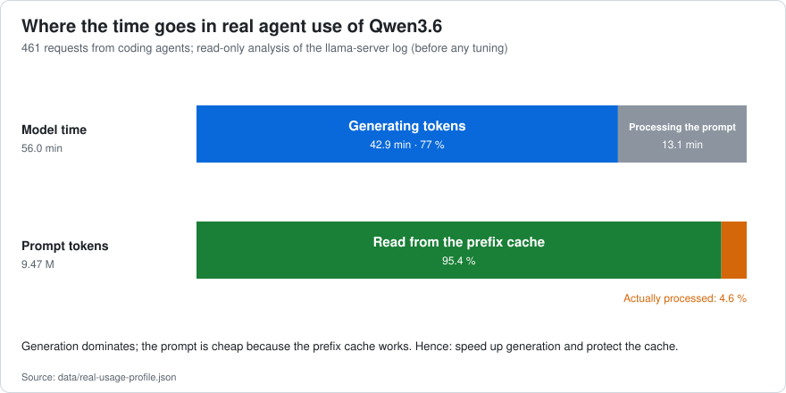
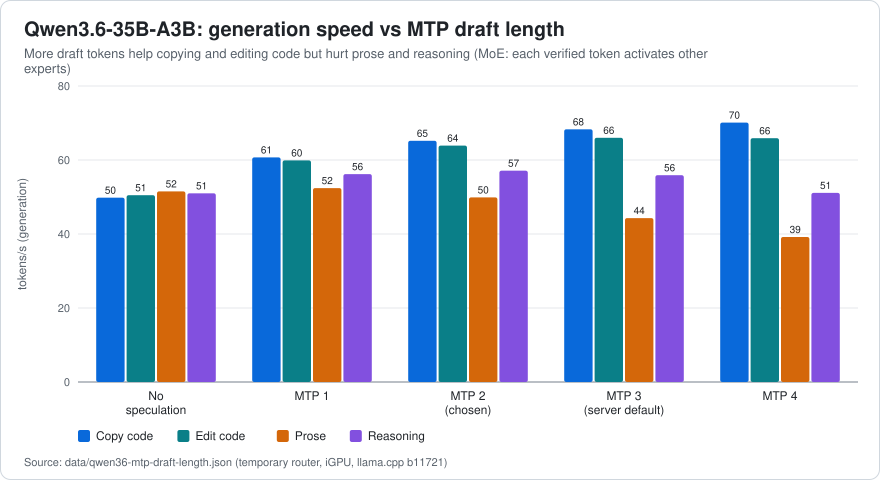
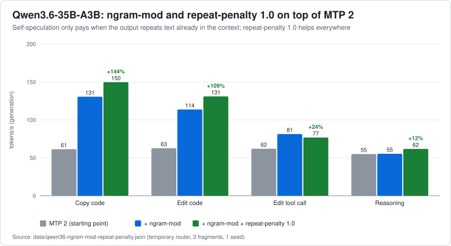
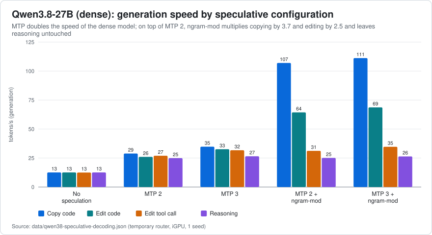

# 03 · Speculative decoding: MTP head + n-gram self-speculation

[← Methodology](02-methodology.md) · [Index](../../README.md) · [Next: Prompt cache, context and compaction →](04-prompt-cache-context-compaction.md)

**Summary.** On this machine the generation speed of both models is limited by memory bandwidth, so the biggest lever is producing *more than one token per pass over the weights*. Combining the model's own multi-token-prediction (MTP) head with n-gram self-speculation (`--spec-type draft-mtp,ngram-mod`) and setting `repeat-penalty 1.0` raised **Qwen3.6-35B-A3B from 70.3 to 121.6 tok/s (+73 %) in the production server** on a realistic mix of agent loads, and **Qwen3.8-27B from 12.6 to 56.9–60.6 tok/s** (26.7 with MTP alone). The gain is concentrated where an agent copies or edits text already in its context (×2.1 to ×2.5 on Qwen3.6, ×3.7 on Qwen3.8 copying, on top of MTP) and is neutral when it reasons.

## 1. Background

Autoregressive decoding needs one pass over the active weights per token, so on a bandwidth-bound machine the speed is roughly *memory bandwidth ÷ bytes of active weights per pass*, times the number of tokens produced per pass. **Speculative decoding** ([Leviathan et al., 2023](https://arxiv.org/abs/2211.17192); [Chen et al., 2023](https://arxiv.org/abs/2302.01318)) proposes several future tokens cheaply and verifies them all in a single pass of the target model; every accepted token is a pass saved, and the output distribution is preserved by the verification rule.

Two sources of draft tokens were used, both available in `llama-server` through `--spec-type` (a comma-separated list; this build offers `none, draft-simple, draft-eagle3, draft-mtp, draft-dflash, draft-dspark, ngram-simple, ngram-map-k, ngram-map-k4v, ngram-mod, ngram-cache`):

| `--spec-type` | Draft source | Cost | Strength |
|---|---|---|---|
| `draft-mtp` | the model's own **multi-token-prediction head** ([Gloeckle et al., 2024](https://arxiv.org/abs/2404.19737); used for speculation in [DeepSeek-V3](https://arxiv.org/abs/2412.19437)), which predicts the next `--spec-draft-n-max` tokens (server default 3) | one extra small layer; no extra model | works for any text, but each extra draft token must be verified |
| `ngram-mod` | an **n-gram lookup**: when the last `--spec-ngram-mod-n-match` tokens (default 24) already occurred earlier, propose what followed then, up to `--spec-ngram-mod-n-max` tokens (defaults: min 48, max 64). The same idea as [prompt lookup decoding](https://github.com/apoorvumang/prompt-lookup-decoding) | no model at all | very long drafts when the output repeats text already seen |

Both can be combined: `--spec-type draft-mtp,ngram-mod`. Whether the GGUF ships the MTP head can be checked with [`tools/gguf-header.mjs`](../../tools/gguf-header.mjs) (look for `nextn` tensors); both models used here do.

## 2. Where the time goes in agent use

Before tuning anything, a read-only analysis of the production server log (461 requests of coding agents to Qwen3.6) showed:

- **77 % of the model's time was generation** (42.9 min at 50.9 tok/s) and 23 % prompt processing (13.1 min). The prompt was cheap because the prefix cache worked: only **4.6 %** of the 9.47 M prompt tokens were actually processed.
- The 8 % of requests that generate 1,000–3,000 tokens (almost always reasoning) produced **42 %** of all generated tokens.
- MTP with 2 draft tokens already accepted **77.3 %** of the proposed tokens (79,224 of 102,449), 2.55 tokens per step (maximum 3).

Hence the target: faster *generation*, without hurting *reasoning*.

## 3. Qwen3.6-35B-A3B (MoE): how many MTP draft tokens?

Tokens/s of generation (acceptance of the draft in parentheses); temporary router, five loads ([`data/qwen36-mtp-draft-length.json`](../../data/qwen36-mtp-draft-length.json)):

| Variant | copy | edit | prose | agent step | reasoning | mean of copy/edit/reasoning |
|---|---|---|---|---|---|---|
| no speculation | 49.8 | 50.5 | 51.5 | 51.1 | 51.0 | 50.4 |
| MTP 1 | 60.7 (95 %) | 59.9 (92 %) | 52.4 (65 %) | 54.6 (76 %) | 56.2 (80 %) | 58.9 |
| **MTP 2** | 65.2 (91 %) | 63.9 (86 %) | 49.9 (54 %) | 55.4 (67 %) | 57.1 (71 %) | **62.1** |
| MTP 3 (server default) | 68.3 (86 %) | 66.0 (82 %) | 44.3 (41 %) | 53.4 (58 %) | 55.9 (63 %) | 63.4 |
| MTP 4 | 70.1 (83 %) | 65.9 (75 %) | 39.2 (32 %) | 48.8 (45 %) | 51.1 (52 %) | 62.4 |

- MTP 2 gives **+15 %** over no speculation on the mean of all five loads (58.3 vs 50.8 tok/s) and +31 % copying, +27 % editing, +12 % reasoning.
- More draft tokens keep improving copy and edit (+7 % and +3 % from 2 to 4 tokens) but **lose on prose (−21 %), agent steps (−12 %) and reasoning (−11 %)**, which is where the real traffic is. Acceptance falls quickly with draft length outside copy/edit (prose 54 % → 32 %).
- *Likely explanation (not instrumented):* Qwen3.6 is a mixture of experts; every extra draft token that has to be verified routes to other experts, so verification cost grows faster than the number of accepted tokens when the acceptance is low.
- **Decision: `spec-draft-n-max = 2`** (the server default is 3). Probabilistic draft sampling and a minimum draft probability changed copy/edit by +2–8 % and lost on reasoning: not adopted.

## 4. Adding `ngram-mod` on top of MTP

Tokens/s, quick batch (3 fragments, 1 seed). `edit-tool` is one `edit` tool call copying `old_string` from the context ([`data/qwen36-ngram-mod-repeat-penalty.json`](../../data/qwen36-ngram-mod-repeat-penalty.json)):

| Variant (all with `spec-draft-n-max 2`) | mean | edit-tool | copy | edit | reasoning |
|---|---|---|---|---|---|
| MTP 2 (starting point) | 60.3 | 62.0 | 61.4 | 62.7 | 55.1 |
| + `ngram-mod`, server defaults (24/48/64) | 95.3 (+58 %) | 81.4 (+31 %) | 130.6 (+113 %) | 113.8 (+82 %) | 55.4 |
| + `ngram-mod` 16/16/64 | 95.4 | 87.8 | 124.7 | 114.2 | 54.9 |
| + `ngram-mod` 12/12/32 (*server warns:* `n_match=12 is too small`) | 88.5 | 73.8 | 120.3 | 104.7 | 55.1 |
| + `ngram-mod` 32/32/64 | 89.2 | 78.4 | 129.4 | 94.0 | 55.0 |
| MTP 3 + `ngram-mod` defaults | 93.8 | 80.7 | 127.3 | 112.5 | 54.9 |
| `ngram-mod` only, no MTP | 82.4 | 71.3 | 127.4 | 81.4 | 49.4 |
| + `ngram-mod` defaults + `repeat-penalty 1.0` | **104.9 (+74 %)** | 76.8 | **149.8** | **131.0** | **61.8** |

**Replication with 3 fragments × 3 seeds** (9 requests per cell; `edit-tool` / `edit` / mean): MTP 2 alone 59.1 / 61.9 / 60.5; + `ngram-mod` defaults 79.3 / 103.5 / **91.4 (+51 %)**; + `ngram-mod` defaults + `repeat-penalty 1.0` 81.8 / 131.9 / **106.8 (+77 %)**. Window sizes 16/16/64, 16/8/64 and 20/20/96 gave the same within noise (89.6–92.5), so **the server defaults were kept** (no extra keys).

What the data say:

- **n-gram self-speculation doubles copying and boosts editing, and is exactly neutral when reasoning** (55.1 → 55.4): it only acts when it finds a long match in earlier text. Agents spend their time rewriting files and quoting context, so this is the traffic that benefits. In the server log, during long copies the n-gram drafts were accepted in spans of 31–48 tokens per step, far beyond the 2-token horizon of the MTP head.
- The gain on a tool call is smaller (+31 %) because `new_string` mixes new text with copied text and acceptance falls to 60–70 %.
- The MTP head is still worth keeping: without it the mean drops from 95.3 to 82.4 and reasoning loses 10 %.
- Match windows below 16 are rejected by the server's own warning and are slower; above 24 they win on pure copy but lose on editing.

## 5. `repeat-penalty 1.0`

The starting point used `repeat-penalty 1.1`. A repetition penalty *fights* both n-gram speculation and copying, and it costs sampling time. Setting it to **1.0** (which is also what the Qwen3.6 and Qwen3.8 model cards recommend for coding) gave, on its own, **+9 % on the mean of copy/edit/reasoning (59.3 → 64.9) and +12 % when reasoning**; combined with `ngram-mod` it added another **+27 % when rewriting text** (103.5 → 131.9 tok/s in the replication).

Quality guard (doc 05 batteries, one run per setting): with `repeat-penalty 1.0` Qwen3.6 still answered 10/10 of the easy problems at all four levels and 7/8 of the hard ones at Medium and High (4/8 at Low), with 5–12 % lower times (Medium: 25.1 s vs 28.6 s) and no loops (maximum repetition measure 0.11, a reasoning run cut at the 4,500-token cap). **Caveat:** a loop in some case not covered by the batteries is possible; if you see one, `1.05` is the intermediate setting.

## 6. Result in the real server

The same four loads sent to the production router before and after the change (`spec-type draft-mtp → draft-mtp,ngram-mod`, `repeat-penalty 1.1 → 1.0`; weights in dedicated GPU memory) — [`data/qwen36-production-before-after.json`](../../data/qwen36-production-before-after.json):

| | mean | edit-tool | copy | edit | reasoning |
|---|---|---|---|---|---|
| before | 70.3 | 73.0 | 69.2 | 74.0 | 64.9 |
| **after** | **121.6 (+73 %)** | 89.7 (+23 %) | 173.7 (+151 %) | 148.8 (+101 %) | 74.3 (+14 %) |

Two days later (warm, same loads) production gave 112.6 and 113.5 tok/s; the *first* run after a router restart gave 82.0 tok/s with identical text and identical draft acceptance (cold machine, [doc 02](02-methodology.md) §5). Relative gains in the temporary routers matched those in production; absolute numbers were higher in production.

## 7. Qwen3.8-27B (dense): the same recipe, a different profile

Tokens/s, quick batch, 1 seed ([`data/qwen38-speculative-decoding.json`](../../data/qwen38-speculative-decoding.json)):

| Variant | mean | edit-tool | copy | edit | reasoning |
|---|---|---|---|---|---|
| no speculation | 12.6 | 12.5 | 12.6 | 12.6 | 12.6 |
| MTP 2 | 26.7 | 27.0 | 28.9 | 26.0 | 24.9 |
| MTP 3 | 31.4 | 31.7 | 34.8 | 32.6 | 26.5 |
| **MTP 2 + `ngram-mod`** | **56.9** | 31.2 | **107.0** | **64.4** | 25.1 |
| MTP 3 + `ngram-mod` | 60.3 | 34.7 | 111.2 | 68.7 | 26.4 |

- A dense 27 B model reads all its weights for every token, so it starts at 12.6 tok/s; **MTP alone doubles it (26.7)** and `ngram-mod` on top **multiplies copying by 3.7 and editing by 2.5 relative to MTP 2** while leaving reasoning untouched (24.9 → 25.1).
- *Repetition with two other seeds* (23 and 37): MTP 2/3/4 + `ngram-mod` gave 60.6 / 61.8 / 61.3 tok/s: **a tie within ±2 %**, so the +6 % of MTP 3 in the first batch was noise. Acceptance when reasoning fell from 73 % (MTP 2) to 62 % (MTP 3) and 56 % (MTP 4), so **MTP 2** was kept. Mean of the two MTP 2 + `ngram-mod` batches: 58.8 tok/s vs 26.7 without `ngram-mod`.
- In absolute terms Qwen3.8 is the slower model: ~25 tok/s when reasoning vs ~74 for Qwen3.6 in production, and it reads prompts at 150–225 tok/s vs 196–720 ([doc 04](04-prompt-cache-context-compaction.md) §8). It is a *quality* choice, not a speed one: see [doc 06](06-recipes.md) for when to use which.

## 8. Does it generalise? A cross-check on a model without an MTP head

The same `ngram-mod` idea was applied to NVIDIA Nemotron 3.5 Bolt, a hybrid model whose GGUF has **no** MTP tensors (verified by reading its header). It still benefited: generation mean **23.9 → 43.0–43.7 tok/s (+80 to +84 %)**, copy 23.7 → 56–61, edit 23.9 → 49–59, reasoning unchanged (24.0 → 23.6–24.5); in production 26.6 → 44.3 (+67 %). Conclusion: the n-gram half of the recipe is model-agnostic and pays wherever the output repeats the context; the MTP half needs the head.

## 9. Practical rules

1. **Check the head first.** `node tools/gguf-header.mjs model.gguf` → `nextn_predict_layers` > 0 and `nextn` tensors present. Some re-quantised or "abliterated" GGUFs drop it.
2. **MoE with MTP:** `spec-type = draft-mtp,ngram-mod`, `spec-draft-n-max = 2`, defaults for the n-gram window, `repeat-penalty = 1.0`. **Dense with MTP:** the same.
3. **No MTP head:** `spec-type = ngram-mod` with window 16/16/48 (measured on Nemotron).
4. **Verify it is active:** the server log must show the MTP draft context being created, and every response carries `timings.draft_n` / `timings.draft_n_accepted` (the benchmark in [`bench/`](../../bench/) prints the acceptance per workload). If acceptance is 0 for every request, speculation is not running.
5. **Do not expect gains on pure reasoning.** The gain scales with how much of the output repeats the context.

Next: [prompt cache, context and compaction](04-prompt-cache-context-compaction.md).
