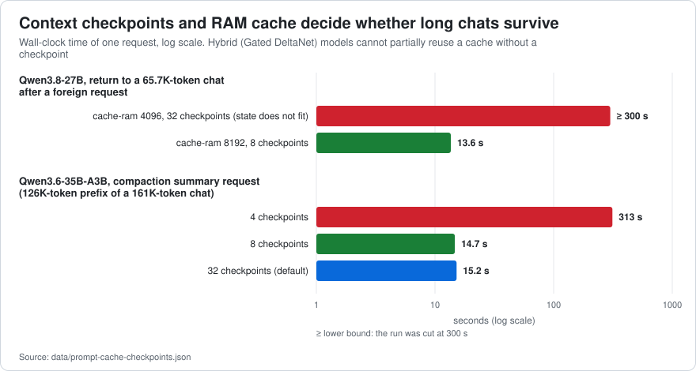
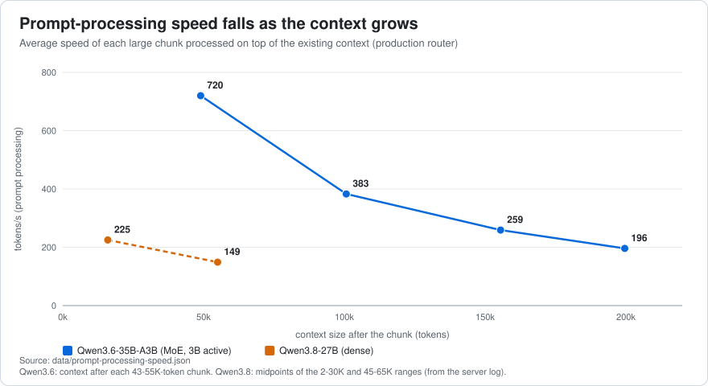

# 04 · Prompt cache, context window and compaction

[← Speculative decoding](03-speculative-decoding.md) · [Index](../../README.md) · [Next: Thinking budgets →](05-thinking-budgets.md)

**Summary.** Both models are *hybrids* (Gated DeltaNet recurrent layers + a few full-attention layers). A hybrid cannot reuse a cache "up to the middle of a prompt": it needs a saved **context checkpoint** at (or before) the point where the new prompt diverges. With cache settings that look reasonable (a small `--cache-ram`, few checkpoints to save RAM) an agent that alternates between chats, or that compacts its context, silently falls into **full re-processing of the history**: more than 5 minutes for Qwen3.8 at 65K tokens with `cache-ram 4096`, 313 s for a compaction summary on Qwen3.6 at 126K tokens with 4 checkpoints. Sizing `--cache-ram` and `--ctx-checkpoints` to the model brought both cases to **13.6–15 s**. Independently, the context window declared in the agent client must equal the server's real per-slot context, or the client never compacts and the server truncates.

## 1. Why hybrids need checkpoints

A transformer's KV cache can be truncated to any prefix. The recurrent state of a Gated DeltaNet layer ([Yang et al., 2024](https://arxiv.org/abs/2412.06464)) is a running summary of *everything* before it: it cannot be rewound by token. `llama-server` therefore saves **context checkpoints** while it processes a prompt and, for a new request, restores the latest checkpoint that is not past the first differing token. Relevant options in this build:

| Option | Meaning | Default |
|---|---|---|
| `-ctxcp`, `--ctx-checkpoints N` | maximum checkpoints per slot ([PR #15293](https://github.com/ggml-org/llama.cpp/pull/15293)) | 32 |
| `-cms`, `--checkpoint-min-step N` | minimum spacing between checkpoints, in tokens | 8192 |
| `-cram`, `--cache-ram N` | size in MiB of the **RAM prompt cache** that keeps the state of slots evicted by other requests ([PR #16391](https://github.com/ggml-org/llama.cpp/pull/16391)) | 8192 |
| `-np`, `--parallel N` | slots; this work used **1** | auto |

With one slot, *any* other request (the title request of a new chat, a second client, a monitoring job that sends a prompt) takes the slot and evicts the chat that was in it. Coming back is cheap only if the state was saved to the RAM cache. The log tells you when it was not:

```
prompt state size 7230 MiB exceeds cache size limit 4096 MiB, skipping
forcing full prompt re-processing due to lack of cache data (likely due to SWA or hybrid/recurrent memory …)
```

## 2. What a saved chat costs (measured from the server log)

| | Qwen3.6-35B-A3B | Qwen3.8-27B |
|---|---|---|
| One context checkpoint | **62.8 MiB** | **149.6 MiB** |
| Prompt state per 1,000 tokens | ~12.4 MiB | ~39 MiB |
| MTP draft state (extra) | 319 MiB at 161K tokens | not measured |
| Saved chat = state + draft + retained checkpoints | 161K tokens, 32 checkpoints: **4,009 MiB**; with 4 checkpoints: 2,313 MiB | 65.7K tokens: state 2,592 MiB + 8 checkpoints; the 4096-MiB limit is exceeded with 32 checkpoints (7,230 MiB) |

The checkpoints are spaced at least 8,192 tokens apart and only the **N most recent** survive: with `N = 32` they cover the whole history, with `N = 4` only the last ~30K tokens.



## 3. Qwen3.6: the defaults already work

Scenario ([doc 02](02-methodology.md)): a 68-step agent chat that grows to **161,489 tokens**, a foreign 31-token request that takes the only slot, then a return to the chat. Return time ([`data/prompt-cache-checkpoints.json`](../../data/prompt-cache-checkpoints.json)):

| `cache-ram` | checkpoints | saved chat | return to the chat |
|---|---|---|---|
| 8192 MiB (default) | 32 (default) | 4,009 MiB | **14.2 s** (only the 2,372 new tokens re-processed) |
| 8192 | 4 | 2,313 MiB | 13.9 s |
| 4096 | 4 | 2,313 MiB | 14.0 s |

97.2 % of the 5.6 M prompt tokens of the whole run were read from the cache. **Qwen3.6 needs no cache change with its default `cache-ram 8192` / 32 checkpoints.** (An earlier estimate that a 140K-token chat would not fit was wrong: it assumed ~188 MiB per checkpoint; the measured value is 62.8 MiB.)

## 4. Qwen3.8: the cache sized for Qwen3.6 does **not** work

Scenario: a 36-step chat of **65,718 tokens**, a foreign request, return. The Qwen3.8 preset started with `cache-ram 4096` (half the server default of 8192) and 32 checkpoints.

| `cache-ram` | checkpoints | outcome | return |
|---|---|---|---|
| 4096 MiB (the preset's value) | 32 | state 7,230 MiB exceeds the limit: **not saved** | **full re-processing: > 300 s** (the first attempt was cut by a 300 s client timeout; at 150–225 tok/s it is 5–7 min) |
| **8192 MiB** | **8** | saved | **13.6 s** (1,785 of 67,499 tokens processed) |
| 4096 MiB | 8 | saved, just fits | 13.7 s |

The saved state grows ~39 MiB per 1,000 tokens (plus 150 MiB per checkpoint): ~4.5 GiB at 85K tokens, ~6.4 GiB at 131K and ~11.5 GiB at 262K (estimate by extrapolation, **not tested**). Rule of thumb used here: `cache-ram ≥ 39 MiB × (context in thousands of tokens) + 150 MiB × checkpoints`, so **4096 is enough only up to ~70K tokens, 8192 covers a 131K window, and a 262K window would need about 12,288**. *Not run:* the server default of 8192 MiB with 32 checkpoints for this model; by the same formula it would fit up to about 87K tokens (8192 − 32 × 149.6 MiB leaves ~3,400 MiB for the state) and fail again beyond.

## 5. Context compaction: why 8 checkpoints, not 4

Coding agents keep a context budget and, when it is nearly full, **compact**: they ask the model for a summary of the older history and replace it. The agent used here (DSH) builds that request from the *same prefix* as the previous request (system prompt, tools, and the history except the last ~16 %) plus an instruction, expecting the provider to reuse the cache. On a hybrid model that holds only if a checkpoint exists **at or before the end of that prefix**.

Scenario: the same 161K-token Qwen3.6 chat; a summary request over the first 126,230 tokens; only prompt processing measured:

| checkpoints | summary request | tokens re-processed |
|---|---|---|
| 32 (default) | **15.2 s** | 3,393 |
| 12 | 14.7 s | 3,393 |
| **8** | **14.7 s** | 3,393 |
| 4 | **313 s** | **126,230** (0 from cache, ~400 tok/s) |

The prefix ends ~37,000 tokens before the end of the chat, about 4.5 checkpoint spacings; with 8 checkpoints there is always one behind it, with 4 there is none. **A configuration that looked harmless (fewer checkpoints to save RAM) would have added more than five minutes to every compaction.** Verified on a second model: Nemotron 3.5 Bolt, 135,735-token prefix: **6.3 s** with 8 checkpoints. The unexplored alternative, lowering `--checkpoint-min-step`, was not tested.

**Rule:** keep `ctx-checkpoints ≥ 8` (default 32) whenever a client compacts by summarising a prefix; reduce RAM through `cache-ram`/`checkpoints` only after measuring the summary request.

## 6. The context window the client believes must equal the server's

The agent decides when to compact from the window **it was told**: `threshold = min(window × ratio, window − maxTokens − headroom)`. In the profile used here, `ratio 0.65`, `headroom 8192`, `maxTokens 8192`: a 262,144-token window compacts at **170,393 tokens**; the harness's factory policy (ratio 0.8, headroom 65,536) gives 163,840.

A different model (Nemotron) exposed the failure mode: the client believed 262,144 tokens, the server's slot had **131,072** (`n_ctx_slot = 131072` in the log). The client's threshold (170,393) could never be reached; at 131,071 tokens the server truncated and every request ended with *"Output token limit reached"* — even "continue" failed because the context stayed full — while the client's gauge read 50 %. The same latent error existed for Qwen3.8 (preset `ctx-size 131072`, client declaring 262,144). **Check the real per-slot context** (the log line `n_ctx_slot`, or `n_ctx` in `GET /props?model=<id>&autoload=false`) **and put exactly that number in the client.** Remember that with `--parallel N` and non-unified KV each slot gets `ctx-size / N`.

## 7. A real compaction, observed

In the agent's desktop window, a chat was filled with four large documents until the context reached **199,563 tokens (76 %)**, above the 170,393 threshold:

| Step | Result |
|---|---|
| Summary request (155,500 tokens summarised) | **29 s**: 397 new prompt tokens (2.0 s) + 964 generated tokens (26.9 s), no thinking |
| Context after compaction | **52,153 tokens (20 %)** |
| Main request afterwards | prefix changed, so the retained 44,000-token message had to be read again: **63 s** at 720 tok/s |
| Whole turn | 1 min 47 s; the model kept the thread (it recalled the first document and the count of documents) |

Lessons: the margin between threshold and window (35 % = 91,000 tokens) means one huge tool result can overflow before compaction can act; compaction is cheap to *summarise* and expensive to *re-read what it keeps* (the retained tail, not the summary, dominated); and the summary was fast because it ran with thinking off ([doc 05](05-thinking-budgets.md)).

## 8. Prompt-processing speed and batch sizes



Speed of reading the prompt falls as the context grows (attention over a longer history): Qwen3.6 720 → 383 → 259 → 196 tok/s over four ~45–55K-token chunks from an empty to a 200K context; Qwen3.8 (dense) reads at 150–225 tok/s throughout the measured range (median 186). Generating with a 32K-token context runs at ~40 tok/s instead of 55–60 on a short one: *the cost of context*, not a setting.

Batch sizes ([`data/prompt-processing-speed.json`](../../data/prompt-processing-speed.json); Qwen3.6, tok/s):

| Setting | 8K new | 32K new | +8K over 32K |
|---|---|---|---|
| **`batch 2048`, `ubatch 1024`, KV `q8_0`** | **875** | **703** | **517** |
| `ubatch 512` | 894 | 680 | 486 |
| `batch 2048`, `ubatch 2048` | 631 (−28 %) | 538 (−23 %) | 433 |
| KV `f16` instead of `q8_0` | 870 | 700 | 513 |

`ubatch 2048` is 23–28 % *slower* on this machine; `q8_0` KV costs no speed and halves the memory. Keep `2048/1024` and `q8_0`.

## 9. Checklist

1. `GET /props` / log: real per-slot context = what the client declares.
2. Hybrid model + one slot: `cache-ram` ≥ state of your longest chat (formula in §4) and `ctx-checkpoints` ≥ 8.
3. Watch the log for `exceeds cache size limit` and `forcing full prompt re-processing`: both mean the cache is not saving you.
4. If the agent compacts by summarising a prefix, measure that request once (the benchmark's `--pp` option reports processed vs cached tokens).
