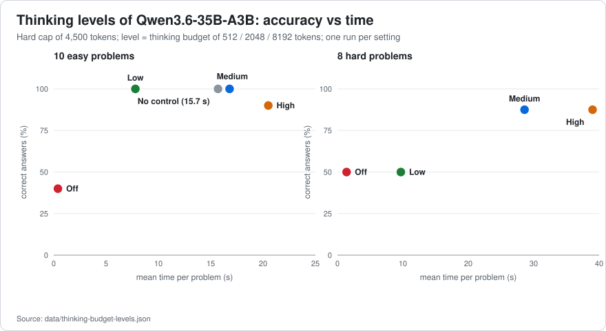

# 05 · Thinking budgets and levels

[← Prompt cache, context, compaction](04-prompt-cache-context-compaction.md) · [Index](../../README.md) · [Next: Recipes →](06-recipes.md)

**Summary.** Qwen's reasoning is the largest single consumer of time (the 8 % of requests that reason produce 42 % of the generated tokens, [doc 03](03-speculative-decoding.md) §2), and the agent harness used here controlled it badly: its "Off" switch sent **nothing**, its "High" level could send a value the template rejects, and a hidden *title* request made every new chat wait ~23 s. Mapping the client's four levels to what the chat templates actually understand turned the selector into a real control: on Qwen3.6, **Medium (a 2,048-token thinking budget) matched High's accuracy on hard problems in 73 % of the time**, **Low halved the time of easy problems at equal accuracy**, a true **Off** answered trivial questions in 0.3 s instead of 3 s, and the session-title request dropped from **22.8 s to 0.5 s**.

## 1. The controls that exist

| Where | Control | Effect |
|---|---|---|
| server flag | `--reasoning on\|off\|auto`, `--reasoning-format deepseek` | enable thinking; return it separately as `reasoning_content` |
| server flag | `--reasoning-budget N` (`-1` unlimited, `0` end immediately), `--reasoning-budget-message "…"` | default cap on thinking tokens; the message is injected before the end-of-thinking tag when the cap is hit ("budget exhausted, forcing end sequence" in the log). The production value here: 8192 |
| request | `chat_template_kwargs: {"enable_thinking": false}` | the template renders an empty `<think></think>`: **no thinking at all** |
| request | `thinking_budget_tokens: N` (alias `reasoning_budget_tokens`) | per-request cap. *Verified on 2026-10-25* with [`bench/thinking-check.mjs`](../../bench/thinking-check.mjs): on a prompt whose reasoning had not finished after 4,423 characters (1,200-token cap), a budget of `32` cut it to 128 characters and the answer followed in 5.5 s; the alias gave the same (128 characters, 5.9 s) — both field names work in this build |
| Qwen3.6 template | `enable_thinking`, `preserve_thinking` | no `reasoning_effort` |
| Qwen3.8 template | `enable_thinking`, **`reasoning_effort` ∈ {`xhigh` (default), `medium`, `low`}**, `preserve_thinking` | any other value **raises an exception → HTTP 500**: *"Unexpected reasoning effort high. Supported types are xhigh (default), medium, and low"* |

`preserve_thinking: true` keeps the reasoning of previous turns in the history. The server logs *"chat template supports preserving reasoning, it is enabled by default"*; the effect is a **stable prefix**, which is part of why 95–98 % of prompt tokens come from the cache ([doc 04](04-prompt-cache-context-compaction.md)).

## 2. What the agent harness sent (and why it was wrong)

Observed with a real coding-agent harness (DSH) pointed at a request-logging fake provider (no GPU needed; [`tools/log-requests.mjs`](../../tools/log-requests.mjs) is an equivalent). Other clients may differ; **log what yours sends**:

| Client level | What it sent to Qwen3.6 | What it sent to Qwen3.8 |
|---|---|---|
| Off | **nothing** → the server thinks with its default cap of 8,192 tokens | **nothing** |
| Low / Medium / High | `reasoning_effort` (ignored by the template) + a budget of 512 / 2048 / 8192 | `reasoning_effort: low / medium / high` → **`high` fails with HTTP 500**; no token cap |

Every chat with Qwen3.8 at the High level failed on its first request. The fix is a mapping, not a model change:

| Client level | Qwen3.6 request body (additions) | Qwen3.8 request body (additions) |
|---|---|---|
| Off | `"chat_template_kwargs": {"enable_thinking": false, "preserve_thinking": true}` | the same |
| Low | `"chat_template_kwargs": {"enable_thinking": true, "preserve_thinking": true}, "thinking_budget_tokens": 512` | the same plus `"reasoning_effort": "low"` inside `chat_template_kwargs`, `"thinking_budget_tokens": 512` |
| Medium | same with `2048` | `"reasoning_effort": "medium"`, `2048` |
| High | same with `8192` | **`"reasoning_effort": "xhigh"`**, `8192` |

The complete mapping as data is in [`configs/clients/thinking-levels.json`](../../configs/clients/thinking-levels.json).

```bash
# Qwen3.6, "Medium" level
curl -s http://127.0.0.1:8080/v1/chat/completions -H "Authorization: Bearer $KEY" -H "Content-Type: application/json" -d '{
  "model": "qwen3.6",
  "messages": [{"role": "user", "content": "Reason step by step: …"}],
  "chat_template_kwargs": {"enable_thinking": true, "preserve_thinking": true},
  "thinking_budget_tokens": 2048
}'
```

The agent-harness syntax used to express this mapping is in [`configs/clients/`](../../configs/clients/).

## 3. Accuracy vs time



Qwen3.6-35B-A3B, 10 easy and 8 hard problems with a single checkable answer ([doc 02](02-methodology.md) §6), one run per setting, cap 4,500 tokens ([`data/thinking-budget-levels.json`](../../data/thinking-budget-levels.json)):

| Level (what is sent) | Easy: correct · mean time · tokens | Hard: correct · mean time · tokens |
|---|---|---|
| no control (server default budget 8,192) | 10/10 · 15.7 s · 921 | — |
| **Off** (`enable_thinking: false`) | **4/10** · 0.4 s · 4 | **4/8** · 1.4 s · 69 |
| **Low** (budget 512) | **10/10 · 7.8 s** · 475 | 4/8 · 9.7 s · 591 |
| **Medium** (2,048) | 10/10 · 16.8 s · 1,003 | **7/8 · 28.6 s** · 1,740 |
| High (8,192) | 9/10 · 20.5 s · 1,188 | 7/8 · 39.0 s · 2,379 |

- **Off also switches off multi-step problem solving** (3–4 correct of 10). It is the right setting for titles, summaries and trivial questions (it saves 20–38 s there), and the wrong one for work.
- **Low** equals *no control* and Medium on easy problems at half the time, and avoids the long tail: one easy problem made High think 81 s without answering (cut at 4,500 tokens) and *no control* 52 s.
- **Hard problems need the budget:** Low drops to 4/8. **Medium reaches High's 7/8 in 73 % of the time**, without the dangling cut run that High produced. Budgets are *ceilings, not targets*: on easy problems Medium can think as much as *no control*.
- With `repeat-penalty 1.0` ([doc 03](03-speculative-decoding.md) §5) the batteries gave the same accuracy and 5–12 % lower times.
- A second hybrid model (Nemotron 3.5 Bolt) showed the same Off penalty (3/10) and, with its own "efficient reasoning" template switch, equal accuracy in 43 % less time; budgets alone did nothing there because its template ignores `reasoning_effort`. Always read the **template**, not the client's menu.

**Recommended defaults:** *Medium* for general agent work, *Low* for quick edits and simple questions, *Off* only for titles, summaries and trivial queries, and *High* only on purpose. (A first check of the model that replaced Qwen3.6 in the day-to-day role, a fine-tune with the same architecture and template, showed the same ranking: Medium best on both sets, High and "no control" worse and slower.)

## 4. The title request nobody sees

The harness used here starts a *second* request, with the same model and at the same time as the user's first message, to name the session (here: `max_completion_tokens 4096`, **no thinking control**). With one slot the two are served one after the other, and the title goes first:

| Session-title request (5-word title) | default | `enable_thinking: false` |
|---|---|---|
| Qwen3.6-35B-A3B | **22.8 s** (1,398 tokens, ~5,000 characters of reasoning) | **0.5 s** |
| Nemotron 3.5 Bolt | 37.9 s | 0.8 s |

In a captured session the main request of Qwen3.6 did not start answering until second 22.2 for this reason. The same applies to the harness's compaction summary request (it carries no effort level), which then runs without thinking and is fast ([doc 04](04-prompt-cache-context-compaction.md) §7).

Single-question timings with `enable_thinking: false` (same answers): trivial question 3 s → 0.3 s; a code bug 6.3 s → 0.9 s; a riddle 24.5 s → 8.1 s.

## 5. Practical notes

- Changing the level in the middle of a chat **does not cost cache**: after each change, the harness's log showed the whole previous context (6,905, 8,000 and 10,910 tokens) read from the cache, only the new message processed.
- A *high* budget with a model that rambles can burn the whole token cap; keep a hard `max_tokens`/cap and remember that the cap you set is a ceiling.
- Qwen3.8 at the same settings is slower in absolute terms (it is dense, [doc 03](03-speculative-decoding.md) §7) but follows the same mapping; use `high → xhigh` for hard problems.
- **Not measured:** the effect of the levels on long tool-using agent tasks; the batteries are short problems.
