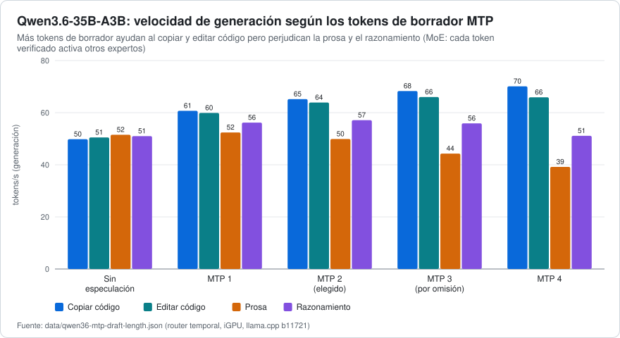
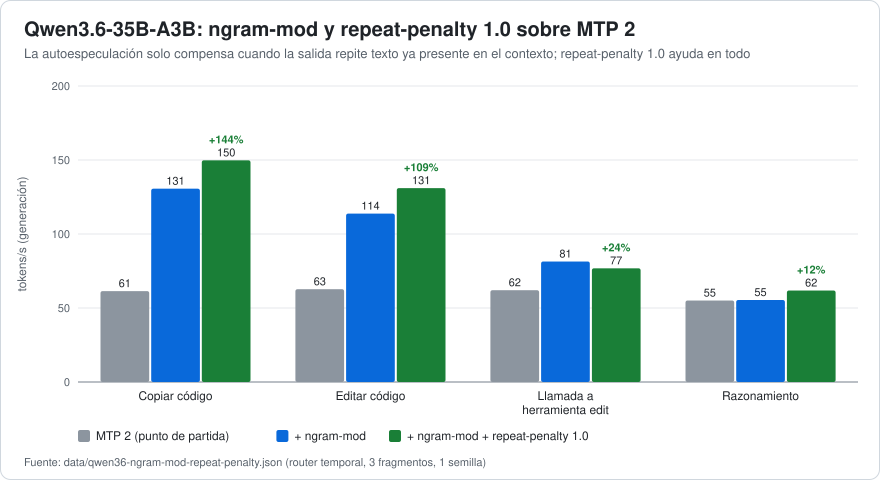
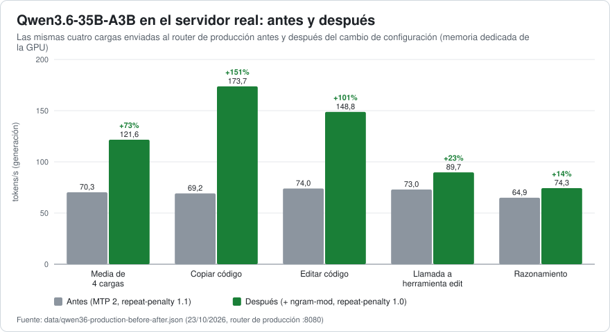
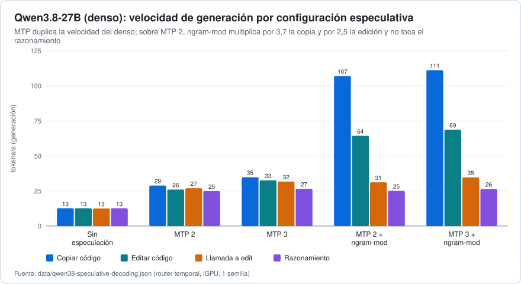

# 03 · Decodificación especulativa: cabeza MTP + autoespeculación con n-gramas

[← Metodología](02-metodologia.md) · [Índice](../../README.es.md) · [Siguiente: Caché del prompt, contexto y compactación →](04-cache-contexto-y-compactacion.md)

**Resumen.** En esta máquina la velocidad de generación de ambos modelos está limitada por el ancho de banda de memoria, así que la palanca más grande es producir *más de un token por pasada sobre los pesos*. Combinar la cabeza de predicción de varios tokens (MTP) del propio modelo con la autoespeculación con n-gramas (`--spec-type draft-mtp,ngram-mod`) y fijar `repeat-penalty 1.0` subió **Qwen3.6-35B-A3B de 70,3 a 121,6 tok/s (+73 %) en el servidor de producción**, con una mezcla realista de cargas de agente, y **Qwen3.8-27B de 12,6 a 56,9–60,6 tok/s** (26,7 solo con MTP). La mejora se concentra donde un agente copia o edita texto que ya está en su contexto (×2,1 a ×2,5 en Qwen3.6, ×3,7 en la copia de Qwen3.8, además de MTP) y es neutra cuando razona.

## 1. Fundamento

La decodificación autorregresiva necesita una pasada sobre los pesos activos por cada token, de modo que en una máquina limitada por el ancho de banda la velocidad es aproximadamente *ancho de banda de memoria ÷ bytes de pesos activos por pasada*, multiplicada por el número de tokens producidos por pasada. La **decodificación especulativa** ([Leviathan et al., 2023](https://arxiv.org/abs/2211.17192); [Chen et al., 2023](https://arxiv.org/abs/2302.01318)) propone varios tokens futuros de forma barata y los verifica todos en una única pasada del modelo objetivo; cada token aceptado es una pasada ahorrada, y la regla de verificación preserva la distribución de la salida.

Se usaron dos fuentes de tokens borrador, ambas disponibles en `llama-server` mediante `--spec-type` (una lista separada por comas; esta compilación ofrece `none, draft-simple, draft-eagle3, draft-mtp, draft-dflash, draft-dspark, ngram-simple, ngram-map-k, ngram-map-k4v, ngram-mod, ngram-cache`):

| `--spec-type` | Fuente del borrador | Coste | Punto fuerte |
|---|---|---|---|
| `draft-mtp` | la propia **cabeza de predicción de varios tokens** del modelo ([Gloeckle et al., 2024](https://arxiv.org/abs/2404.19737); usada para especular en [DeepSeek-V3](https://arxiv.org/abs/2412.19437)), que predice los siguientes `--spec-draft-n-max` tokens (por omisión del servidor, 3) | una capa pequeña adicional; ningún modelo extra | sirve para cualquier texto, pero cada token borrador adicional hay que verificarlo |
| `ngram-mod` | una **búsqueda de n-gramas**: cuando los últimos `--spec-ngram-mod-n-match` tokens (por omisión, 24) ya aparecieron antes, propone lo que vino a continuación, hasta `--spec-ngram-mod-n-max` tokens (por omisión: mín. 48, máx. 64). La misma idea que [*Prompt Lookup Decoding*](https://github.com/apoorvumang/prompt-lookup-decoding) | ningún modelo | borradores muy largos cuando la salida repite texto ya visto |

Se pueden combinar: `--spec-type draft-mtp,ngram-mod`. Si el GGUF incluye la cabeza MTP se comprueba con [`tools/gguf-header.mjs`](../../tools/gguf-header.mjs) (busca tensores `nextn`); los dos modelos usados aquí la incluyen.

## 2. Dónde se va el tiempo en el uso con agentes

Antes de ajustar nada, un análisis de solo lectura del registro del servidor de producción (461 peticiones de agentes de programación a Qwen3.6) mostró:

- **El 77 % del tiempo del modelo fue generación** (42,9 min a 50,9 tok/s) y el 23 % procesamiento del prompt (13,1 min). El prompt salió barato porque la caché de prefijos funcionaba: solo se procesó realmente el **4,6 %** de los 9,47 M de tokens de prompt.
- El 8 % de las peticiones, las que generan entre 1000 y 3000 tokens (casi siempre razonamiento), produjo el **42 %** de todos los tokens generados.
- MTP con 2 tokens borrador ya aceptaba el **77,3 %** de los tokens propuestos (79 224 de 102 449), 2,55 tokens por paso (máximo 3).

De ahí el objetivo: *generación* más rápida, sin dañar el *razonamiento*.

## 3. Qwen3.6-35B-A3B (MoE): ¿cuántos tokens borrador de MTP?

Tokens/s de generación (aceptación del borrador entre paréntesis); router temporal, cinco cargas ([`data/qwen36-mtp-draft-length.json`](../../data/qwen36-mtp-draft-length.json)):

| Variante | copy | edit | prose | paso de agente | razonamiento | media de copy/edit/razonamiento |
|---|---|---|---|---|---|---|
| sin especulación | 49,8 | 50,5 | 51,5 | 51,1 | 51,0 | 50,4 |
| MTP 1 | 60,7 (95 %) | 59,9 (92 %) | 52,4 (65 %) | 54,6 (76 %) | 56,2 (80 %) | 58,9 |
| **MTP 2** | 65,2 (91 %) | 63,9 (86 %) | 49,9 (54 %) | 55,4 (67 %) | 57,1 (71 %) | **62,1** |
| MTP 3 (por omisión del servidor) | 68,3 (86 %) | 66,0 (82 %) | 44,3 (41 %) | 53,4 (58 %) | 55,9 (63 %) | 63,4 |
| MTP 4 | 70,1 (83 %) | 65,9 (75 %) | 39,2 (32 %) | 48,8 (45 %) | 51,1 (52 %) | 62,4 |

- MTP 2 da **+15 %** sobre la ausencia de especulación en la media de las cinco cargas (58,3 frente a 50,8 tok/s) y +31 % al copiar, +27 % al editar, +12 % al razonar.
- Más tokens borrador siguen mejorando copy y edit (+7 % y +3 % de 2 a 4 tokens), pero **pierden en prosa (−21 %), pasos de agente (−12 %) y razonamiento (−11 %)**, que es donde está el tráfico real. La aceptación cae deprisa con la longitud del borrador fuera de copy/edit (prosa, 54 % → 32 %).
- *Explicación probable (no instrumentada):* Qwen3.6 es una mezcla de expertos; cada token borrador adicional que hay que verificar se enruta a otros expertos, así que el coste de verificación crece más deprisa que el número de tokens aceptados cuando la aceptación es baja.
- **Decisión: `spec-draft-n-max = 2`** (el valor por omisión del servidor es 3). El muestreo probabilístico del borrador y una probabilidad mínima del borrador cambiaron copy/edit entre +2 y +8 % y perdieron en razonamiento: no se adoptaron.

## 4. Añadir `ngram-mod` sobre MTP

Tokens/s, lote rápido (3 fragmentos, 1 semilla). `edit-tool` es una llamada a la herramienta `edit` que copia `old_string` del contexto ([`data/qwen36-ngram-mod-repeat-penalty.json`](../../data/qwen36-ngram-mod-repeat-penalty.json)):

| Variante (todas con `spec-draft-n-max 2`) | media | edit-tool | copy | edit | razonamiento |
|---|---|---|---|---|---|
| MTP 2 (punto de partida) | 60,3 | 62,0 | 61,4 | 62,7 | 55,1 |
| + `ngram-mod`, valores por omisión del servidor (24/48/64) | 95,3 (+58 %) | 81,4 (+31 %) | 130,6 (+113 %) | 113,8 (+82 %) | 55,4 |
| + `ngram-mod` 16/16/64 | 95,4 | 87,8 | 124,7 | 114,2 | 54,9 |
| + `ngram-mod` 12/12/32 (*el servidor avisa:* `n_match=12 is too small`) | 88,5 | 73,8 | 120,3 | 104,7 | 55,1 |
| + `ngram-mod` 32/32/64 | 89,2 | 78,4 | 129,4 | 94,0 | 55,0 |
| MTP 3 + `ngram-mod` por omisión | 93,8 | 80,7 | 127,3 | 112,5 | 54,9 |
| solo `ngram-mod`, sin MTP | 82,4 | 71,3 | 127,4 | 81,4 | 49,4 |
| + `ngram-mod` por omisión + `repeat-penalty 1.0` | **104,9 (+74 %)** | 76,8 | **149,8** | **131,0** | **61,8** |

**Replicación con 3 fragmentos × 3 semillas** (9 peticiones por celda; `edit-tool` / `edit` / media): solo MTP 2, 59,1 / 61,9 / 60,5; + `ngram-mod` por omisión, 79,3 / 103,5 / **91,4 (+51 %)**; + `ngram-mod` por omisión + `repeat-penalty 1.0`, 81,8 / 131,9 / **106,8 (+77 %)**. Los tamaños de ventana 16/16/64, 16/8/64 y 20/20/96 dieron lo mismo dentro del ruido (89,6–92,5), así que **se mantuvieron los valores por omisión del servidor** (sin claves adicionales).

Lo que dicen los datos:

- **La autoespeculación con n-gramas duplica la copia y potencia la edición, y es exactamente neutra al razonar** (55,1 → 55,4): solo actúa cuando encuentra una coincidencia larga en texto anterior. Los agentes pasan el tiempo reescribiendo ficheros y citando contexto, así que este es el tráfico que se beneficia. En el registro del servidor, durante las copias largas los borradores de n-gramas se aceptaron en tramos de 31–48 tokens por paso, muy por encima del horizonte de 2 tokens de la cabeza MTP.
- La mejora en una llamada a herramienta es menor (+31 %) porque `new_string` mezcla texto nuevo con texto copiado y la aceptación baja al 60–70 %.
- La cabeza MTP sigue mereciendo la pena: sin ella la media baja de 95,3 a 82,4 y el razonamiento pierde un 10 %.
- Las ventanas de coincidencia por debajo de 16 las rechaza el propio aviso del servidor y son más lentas; por encima de 24 ganan en copia pura pero pierden en edición.

## 5. `repeat-penalty 1.0`

El punto de partida usaba `repeat-penalty 1.1`. Una penalización por repetición *lucha* contra la especulación con n-gramas y contra la copia, y cuesta tiempo de muestreo. Fijarla en **1,0** (que es además lo que recomiendan las fichas de Qwen3.6 y Qwen3.8 para programar) dio, por sí sola, **+9 % en la media de copy/edit/razonamiento (59,3 → 64,9) y +12 % al razonar**; combinada con `ngram-mod` añadió otro **+27 % al reescribir texto** (103,5 → 131,9 tok/s en la replicación).

Control de calidad (baterías del doc 05, una ejecución por ajuste): con `repeat-penalty 1.0` Qwen3.6 siguió acertando 10/10 de los problemas fáciles en los cuatro niveles y 7/8 de los difíciles en Medium y High (4/8 en Low), con tiempos entre un 5 y un 12 % menores (Medium: 25,1 s frente a 28,6 s) y sin bucles (medida de repetición máxima 0,11, una ejecución de razonamiento cortada en el tope de 4500 tokens). **Salvedad:** es posible un bucle en algún caso que las baterías no cubren; si lo ves, `1.05` es el ajuste intermedio.

## 6. Resultado en el servidor real

Las mismas cuatro cargas enviadas al router de producción antes y después del cambio (`spec-type draft-mtp → draft-mtp,ngram-mod`, `repeat-penalty 1.1 → 1.0`; pesos en memoria dedicada de la GPU) — [`data/qwen36-production-before-after.json`](../../data/qwen36-production-before-after.json):

| | media | edit-tool | copy | edit | razonamiento |
|---|---|---|---|---|---|
| antes | 70,3 | 73,0 | 69,2 | 74,0 | 64,9 |
| **después** | **121,6 (+73 %)** | 89,7 (+23 %) | 173,7 (+151 %) | 148,8 (+101 %) | 74,3 (+14 %) |

Dos días después (en caliente, mismas cargas) la producción dio 112,6 y 113,5 tok/s; la *primera* ejecución tras un reinicio del router dio 82,0 tok/s con texto y aceptación del borrador idénticos (máquina en frío, [doc 02](02-metodologia.md) §5). Las mejoras relativas en los routers temporales coincidieron con las de producción; los números absolutos fueron mayores en producción.

## 7. Qwen3.8-27B (denso): la misma receta, un perfil distinto

Tokens/s, lote rápido, 1 semilla ([`data/qwen38-speculative-decoding.json`](../../data/qwen38-speculative-decoding.json)):

| Variante | media | edit-tool | copy | edit | razonamiento |
|---|---|---|---|---|---|
| sin especulación | 12,6 | 12,5 | 12,6 | 12,6 | 12,6 |
| MTP 2 | 26,7 | 27,0 | 28,9 | 26,0 | 24,9 |
| MTP 3 | 31,4 | 31,7 | 34,8 | 32,6 | 26,5 |
| **MTP 2 + `ngram-mod`** | **56,9** | 31,2 | **107,0** | **64,4** | 25,1 |
| MTP 3 + `ngram-mod` | 60,3 | 34,7 | 111,2 | 68,7 | 26,4 |

- Un modelo denso de 27 B lee todos sus pesos en cada token, por eso parte de 12,6 tok/s; **MTP por sí solo lo duplica (26,7)** y `ngram-mod` encima **multiplica la copia por 3,7 y la edición por 2,5 respecto a MTP 2**, dejando intacto el razonamiento (24,9 → 25,1).
- *Repetición con otras dos semillas* (23 y 37): MTP 2/3/4 + `ngram-mod` dieron 60,6 / 61,8 / 61,3 tok/s: **un empate dentro del ±2 %**, de modo que el +6 % de MTP 3 en el primer lote era ruido. La aceptación al razonar cayó del 73 % (MTP 2) al 62 % (MTP 3) y al 56 % (MTP 4), así que se mantuvo **MTP 2**. Media de los dos lotes de MTP 2 + `ngram-mod`: 58,8 tok/s frente a 26,7 sin `ngram-mod`.
- En términos absolutos Qwen3.8 es el modelo más lento: ~25 tok/s al razonar frente a ~74 de Qwen3.6 en producción, y lee prompts a 150–225 tok/s frente a 196–720 ([doc 04](04-cache-contexto-y-compactacion.md) §8). Es una elección de *calidad*, no de velocidad: véase el [doc 06](06-recetas.md) para saber cuándo usar cada uno.

## 8. ¿Se generaliza? Una comprobación en un modelo sin cabeza MTP

La misma idea de `ngram-mod` se aplicó a NVIDIA Nemotron 3.5 Bolt, un modelo híbrido cuyo GGUF **no** tiene tensores MTP (verificado leyendo su cabecera). Aun así se benefició: media de generación **23,9 → 43,0–43,7 tok/s (+80 a +84 %)**, copy 23,7 → 56–61, edit 23,9 → 49–59, razonamiento sin cambios (24,0 → 23,6–24,5); en producción 26,6 → 44,3 (+67 %). Conclusión: la mitad de n-gramas de la receta es independiente del modelo y rinde allí donde la salida repite el contexto; la mitad MTP necesita la cabeza.

## 9. Reglas prácticas

1. **Comprueba primero la cabeza.** `node tools/gguf-header.mjs model.gguf` → `nextn_predict_layers` > 0 y tensores `nextn` presentes. Algunos GGUF recuantizados o «abliterados» la eliminan.
2. **MoE con MTP:** `spec-type = draft-mtp,ngram-mod`, `spec-draft-n-max = 2`, valores por omisión para la ventana de n-gramas, `repeat-penalty = 1.0`. **Denso con MTP:** lo mismo.
3. **Sin cabeza MTP:** `spec-type = ngram-mod` con ventana 16/16/48 (medido en Nemotron).
4. **Verifica que está activo:** el registro del servidor debe mostrar la creación del contexto del borrador MTP, y cada respuesta lleva `timings.draft_n` / `timings.draft_n_accepted` (el benchmark de [`bench/`](../../bench/) imprime la aceptación por carga). Si la aceptación es 0 en todas las peticiones, la especulación no está funcionando.
5. **No esperes mejoras en razonamiento puro.** La mejora crece con la parte de la salida que repite el contexto.

Siguiente: [caché del prompt, contexto y compactación](04-cache-contexto-y-compactacion.md).
