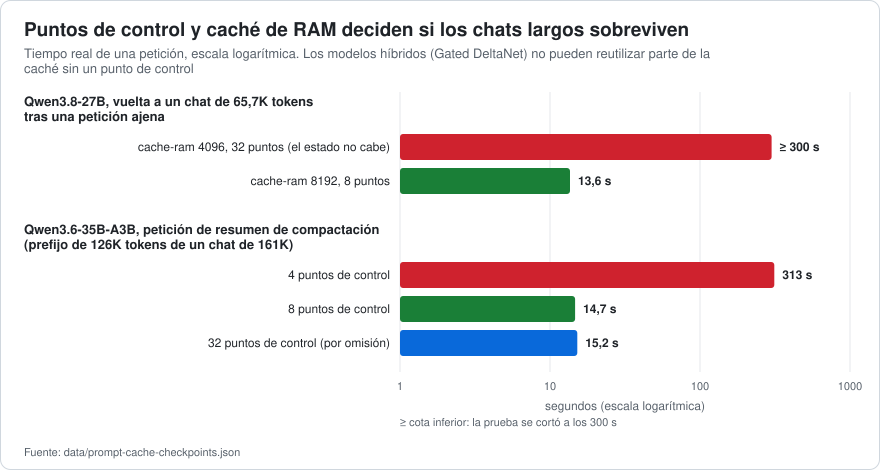
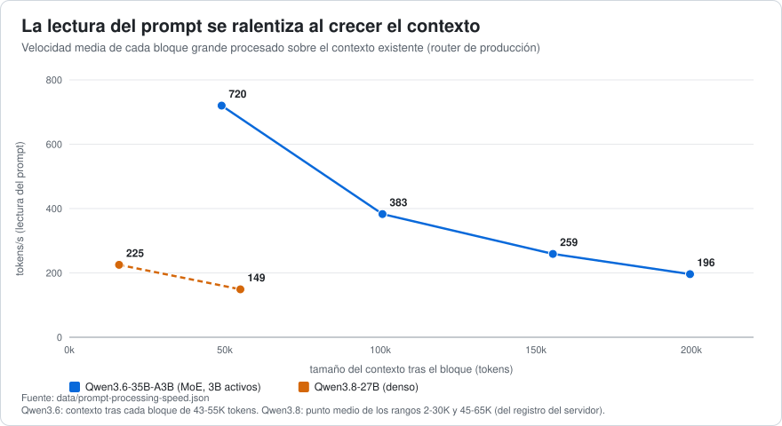

# 04 · Caché del prompt, ventana de contexto y compactación

[← Decodificación especulativa](03-decodificacion-especulativa.md) · [Índice](../../README.es.md) · [Siguiente: Presupuestos de pensamiento →](05-presupuestos-de-pensamiento.md)

**Resumen.** Los dos modelos son *híbridos* (capas recurrentes Gated DeltaNet + unas pocas capas de atención completa). Un híbrido no puede reutilizar una caché «hasta la mitad de un prompt»: necesita un **punto de control de contexto** guardado en el punto (o antes) en que diverge el nuevo prompt. Con unos ajustes de caché que parecen razonables (un `--cache-ram` pequeño, pocos puntos de control para ahorrar RAM), un agente que alterna entre chats, o que compacta su contexto, cae en silencio en el **reprocesamiento completo del historial**: más de 5 minutos con Qwen3.8 a 65 000 tokens con `cache-ram 4096`, 313 s para un resumen de compactación en Qwen3.6 a 126 000 tokens con 4 puntos de control. Dimensionar `--cache-ram` y `--ctx-checkpoints` según el modelo llevó ambos casos a **13,6–15 s**. Aparte, la ventana de contexto declarada en el cliente del agente debe ser igual al contexto real por slot del servidor; si no, el cliente nunca compacta y el servidor trunca.

## 1. Por qué los híbridos necesitan puntos de control

La caché KV de un transformer puede truncarse en cualquier prefijo. El estado recurrente de una capa Gated DeltaNet ([Yang et al., 2024](https://arxiv.org/abs/2412.06464)) es un resumen acumulado de *todo* lo anterior: no puede rebobinarse token a token. Por eso `llama-server` guarda **puntos de control de contexto** mientras procesa un prompt y, ante una petición nueva, restaura el último punto que no pasa del primer token distinto. Opciones relevantes en esta compilación:

| Opción | Significado | Por omisión |
|---|---|---|
| `-ctxcp`, `--ctx-checkpoints N` | máximo de puntos de control por slot ([PR #15293](https://github.com/ggml-org/llama.cpp/pull/15293)) | 32 |
| `-cms`, `--checkpoint-min-step N` | separación mínima entre puntos de control, en tokens | 8192 |
| `-cram`, `--cache-ram N` | tamaño en MiB de la **caché del prompt en RAM**, que conserva el estado de los slots desalojados por otras peticiones ([PR #16391](https://github.com/ggml-org/llama.cpp/pull/16391)) | 8192 |
| `-np`, `--parallel N` | slots; este trabajo usó **1** | auto |

Con un solo slot, *cualquier* otra petición (la del título de un chat nuevo, un segundo cliente, una tarea de monitorización que envía un prompt) ocupa el slot y desaloja el chat que estaba dentro. Volver a él es barato solo si el estado se guardó en la caché de RAM. El registro te avisa cuando no fue así:

```
prompt state size 7230 MiB exceeds cache size limit 4096 MiB, skipping
forcing full prompt re-processing due to lack of cache data (likely due to SWA or hybrid/recurrent memory …)
```

## 2. Qué cuesta guardar un chat (medido en el registro del servidor)

| | Qwen3.6-35B-A3B | Qwen3.8-27B |
|---|---|---|
| Un punto de control de contexto | **62,8 MiB** | **149,6 MiB** |
| Estado del prompt por cada 1000 tokens | ~12,4 MiB | ~39 MiB |
| Estado del borrador MTP (adicional) | 319 MiB a 161 000 tokens | no medido |
| Chat guardado = estado + borrador + puntos de control retenidos | 161 000 tokens, 32 puntos de control: **4009 MiB**; con 4 puntos de control: 2313 MiB | 65 700 tokens: estado 2592 MiB + 8 puntos de control; el límite de 4096 MiB se supera con 32 puntos de control (7230 MiB) |

Los puntos de control se separan al menos 8192 tokens y solo sobreviven los **N más recientes**: con `N = 32` cubren todo el historial; con `N = 4`, solo los últimos ~30 000 tokens.



## 3. Qwen3.6: los valores por omisión ya funcionan

Escenario ([doc 02](02-metodologia.md)): un chat de agente de 68 pasos que crece hasta **161 489 tokens**, una petición ajena de 31 tokens que ocupa el único slot y luego la vuelta al chat. Tiempo de vuelta ([`data/prompt-cache-checkpoints.json`](../../data/prompt-cache-checkpoints.json)):

| `cache-ram` | puntos de control | chat guardado | vuelta al chat |
|---|---|---|---|
| 8192 MiB (por omisión) | 32 (por omisión) | 4009 MiB | **14,2 s** (solo se reprocesan los 2372 tokens nuevos) |
| 8192 | 4 | 2313 MiB | 13,9 s |
| 4096 | 4 | 2313 MiB | 14,0 s |

El 97,2 % de los 5,6 M de tokens de prompt de toda la ejecución se leyó de la caché. **Qwen3.6 no necesita cambiar la caché con sus valores por omisión `cache-ram 8192` / 32 puntos de control.** (Una estimación anterior, según la cual un chat de 140 000 tokens no cabría, era errónea: suponía ~188 MiB por punto de control; el valor medido es 62,8 MiB.)

## 4. Qwen3.8: la caché dimensionada para Qwen3.6 **no** funciona

Escenario: un chat de 36 pasos de **65 718 tokens**, una petición ajena, vuelta. El preset de Qwen3.8 partía de `cache-ram 4096` (la mitad del valor por omisión del servidor, 8192) y 32 puntos de control.

| `cache-ram` | puntos de control | resultado | vuelta |
|---|---|---|---|
| 4096 MiB (el valor del preset) | 32 | el estado de 7230 MiB supera el límite: **no se guarda** | **reprocesamiento completo: > 300 s** (el primer intento lo cortó un tiempo de espera de 300 s del cliente; a 150–225 tok/s son 5–7 min) |
| **8192 MiB** | **8** | guardado | **13,6 s** (1785 de 67 499 tokens procesados) |
| 4096 MiB | 8 | guardado, justo cabe | 13,7 s |

El estado guardado crece ~39 MiB por cada 1000 tokens (más 150 MiB por punto de control): ~4,5 GiB a 85 000 tokens, ~6,4 GiB a 131 000 y ~11,5 GiB a 262 000 (estimación por extrapolación, **no probada**). Regla práctica usada aquí: `cache-ram ≥ 39 MiB × (contexto en miles de tokens) + 150 MiB × puntos de control`; por tanto, **4096 solo basta hasta ~70 000 tokens, 8192 cubre una ventana de 131 000 y una ventana de 262 000 necesitaría unos 12 288**. *No ejecutado:* el valor por omisión del servidor, 8192 MiB con 32 puntos de control, para este modelo; con la misma fórmula cabría hasta unos 87 000 tokens (8192 − 32 × 149,6 MiB deja ~3400 MiB para el estado) y volvería a fallar más allá.

## 5. Compactación del contexto: por qué 8 puntos de control y no 4

Los agentes de programación mantienen un presupuesto de contexto y, cuando casi se llena, **compactan**: piden al modelo un resumen del historial más antiguo y lo sustituyen. El agente usado aquí (DSH) construye esa petición con el *mismo prefijo* que la petición anterior (prompt de sistema, herramientas e historial salvo el ~16 % final) más una instrucción, esperando que el proveedor reutilice la caché. En un modelo híbrido eso solo ocurre si existe un punto de control **al final de ese prefijo o antes**.

Escenario: el mismo chat de Qwen3.6 de 161 000 tokens; una petición de resumen sobre los primeros 126 230 tokens; solo se mide el procesamiento del prompt:

| puntos de control | petición de resumen | tokens reprocesados |
|---|---|---|
| 32 (por omisión) | **15,2 s** | 3393 |
| 12 | 14,7 s | 3393 |
| **8** | **14,7 s** | 3393 |
| 4 | **313 s** | **126 230** (0 de la caché, ~400 tok/s) |

El prefijo termina ~37 000 tokens antes del final del chat, unas 4,5 separaciones entre puntos de control; con 8 puntos de control siempre hay uno por detrás, con 4 no hay ninguno. **Una configuración que parecía inofensiva (menos puntos de control para ahorrar RAM) habría añadido más de cinco minutos a cada compactación.** Verificado en un segundo modelo: Nemotron 3.5 Bolt, prefijo de 135 735 tokens: **6,3 s** con 8 puntos de control. La alternativa sin explorar, bajar `--checkpoint-min-step`, no se probó.

**Regla:** mantén `ctx-checkpoints ≥ 8` (por omisión, 32) siempre que un cliente compacte resumiendo un prefijo; reduce la RAM mediante `cache-ram`/puntos de control solo después de medir la petición de resumen.

## 6. La ventana de contexto que cree el cliente debe ser igual a la del servidor

El agente decide cuándo compactar a partir de la ventana **que le dijeron**: `threshold = min(window × ratio, window − maxTokens − headroom)`. En el perfil usado aquí, `ratio 0.65`, `headroom 8192`, `maxTokens 8192`: una ventana de 262 144 tokens compacta en **170 393 tokens**; la política de fábrica del arnés (`ratio 0.8`, `headroom 65536`) da 163 840.

Un modelo distinto (Nemotron) expuso el modo de fallo: el cliente creía 262 144 tokens, el slot del servidor tenía **131 072** (`n_ctx_slot = 131072` en el registro). El umbral del cliente (170 393) nunca se podía alcanzar; a 131 071 tokens el servidor truncaba y cada petición acababa con *«Output token limit reached»* —incluso «continúa» fallaba porque el contexto seguía lleno— mientras el indicador del cliente marcaba el 50 %. El mismo error latente existía en Qwen3.8 (preset `ctx-size 131072`, cliente declarando 262 144). **Comprueba el contexto real por slot** (la línea `n_ctx_slot` del registro, o `n_ctx` en `GET /props?model=<id>&autoload=false`) **y pon exactamente ese número en el cliente.** Recuerda que con `--parallel N` y KV no unificado cada slot recibe `ctx-size / N`.

## 7. Una compactación real, observada

En la ventana de escritorio del agente se llenó un chat con cuatro documentos grandes hasta que el contexto llegó a **199 563 tokens (76 %)**, por encima del umbral de 170 393:

| Paso | Resultado |
|---|---|
| Petición de resumen (155 500 tokens resumidos) | **29 s**: 397 tokens de prompt nuevos (2,0 s) + 964 tokens generados (26,9 s), sin pensamiento |
| Contexto tras la compactación | **52 153 tokens (20 %)** |
| Petición principal posterior | el prefijo cambió, así que el mensaje retenido de 44 000 tokens hubo que leerlo otra vez: **63 s** a 720 tok/s |
| Turno completo | 1 min 47 s; el modelo mantuvo el hilo (recordó el primer documento y el número de documentos) |

Lecciones: el margen entre umbral y ventana (35 % = 91 000 tokens) significa que un solo resultado de herramienta enorme puede desbordar antes de que la compactación actúe; la compactación es barata de *resumir* y cara de *releer lo que conserva* (dominó la cola retenida, no el resumen); y el resumen fue rápido porque se ejecutó con el pensamiento desactivado ([doc 05](05-presupuestos-de-pensamiento.md)).

## 8. Velocidad de procesamiento del prompt y tamaños de lote



La velocidad de lectura del prompt cae al crecer el contexto (atención sobre un historial más largo): Qwen3.6, 720 → 383 → 259 → 196 tok/s a lo largo de cuatro bloques de ~45 000–55 000 tokens desde un contexto vacío hasta uno de 200 000; Qwen3.8 (denso) lee a 150–225 tok/s en todo el rango medido (mediana 186). Generar con un contexto de 32 000 tokens va a ~40 tok/s en lugar de 55–60 con uno corto: *el coste del contexto*, no un ajuste.

Tamaños de lote ([`data/prompt-processing-speed.json`](../../data/prompt-processing-speed.json); Qwen3.6, tok/s):

| Ajuste | 8000 nuevos | 32 000 nuevos | +8000 sobre 32 000 |
|---|---|---|---|
| **`batch 2048`, `ubatch 1024`, KV `q8_0`** | **875** | **703** | **517** |
| `ubatch 512` | 894 | 680 | 486 |
| `batch 2048`, `ubatch 2048` | 631 (−28 %) | 538 (−23 %) | 433 |
| KV `f16` en lugar de `q8_0` | 870 | 700 | 513 |

`ubatch 2048` es un 23–28 % *más lento* en esta máquina; el KV `q8_0` no cuesta velocidad y reduce la memoria a la mitad. Mantén `2048/1024` y `q8_0`.

## 9. Lista de comprobación

1. `GET /props` / registro: el contexto real por slot = lo que declara el cliente.
2. Modelo híbrido + un slot: `cache-ram` ≥ estado de tu chat más largo (fórmula del §4) y `ctx-checkpoints` ≥ 8.
3. Vigila en el registro `exceeds cache size limit` y `forcing full prompt re-processing`: ambos significan que la caché no te está salvando.
4. Si el agente compacta resumiendo un prefijo, mide esa petición una vez (la opción `--pp` del benchmark informa de tokens procesados frente a tokens en caché).
