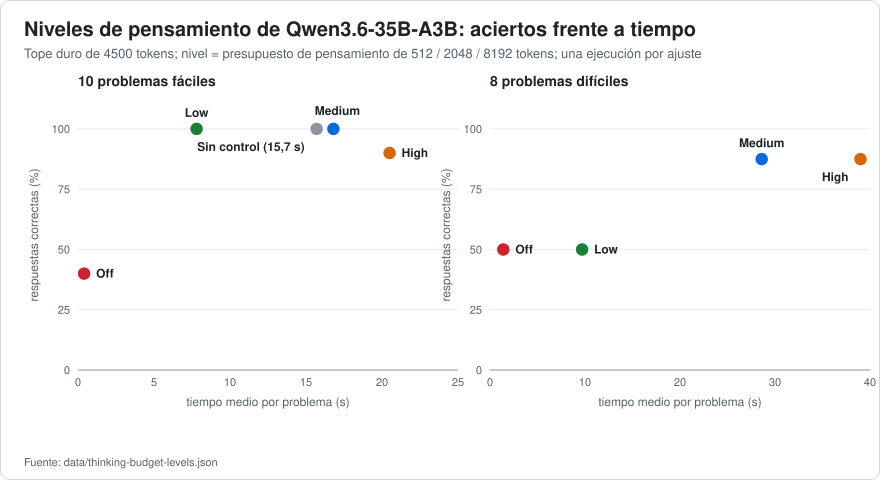

# 05 · Presupuestos y niveles de pensamiento

[← Caché del prompt, contexto y compactación](04-cache-contexto-y-compactacion.md) · [Índice](../../README.es.md) · [Siguiente: Recetas →](06-recetas.md)

**Resumen.** El razonamiento de Qwen es el mayor consumidor de tiempo (el 8 % de las peticiones que razonan produce el 42 % de los tokens generados, [doc 03](03-decodificacion-especulativa.md) §2), y el arnés de agente usado aquí lo controlaba mal: su «Off» no enviaba **nada**, su nivel «High» podía enviar un valor que la plantilla rechaza, y una petición oculta de *título* hacía que cada chat nuevo esperase ~23 s. Traducir los cuatro niveles del cliente a lo que las plantillas de chat entienden de verdad convirtió el selector en un control real: en Qwen3.6, **Medium (un presupuesto de pensamiento de 2048 tokens) igualó la precisión de High en problemas difíciles en el 73 % del tiempo**, **Low redujo a la mitad el tiempo de los problemas fáciles con la misma precisión**, un **Off** verdadero respondió preguntas triviales en 0,3 s en lugar de 3 s, y la petición del título de sesión bajó de **22,8 s a 0,5 s**.

## 1. Los controles que existen

| Dónde | Control | Efecto |
|---|---|---|
| opción del servidor | `--reasoning on\|off\|auto`, `--reasoning-format deepseek` | activa el pensamiento; lo devuelve por separado como `reasoning_content` |
| opción del servidor | `--reasoning-budget N` (`-1` ilimitado, `0` terminar de inmediato), `--reasoning-budget-message "…"` | tope por omisión de tokens de pensamiento; el mensaje se inyecta antes de la etiqueta de fin de pensamiento cuando se alcanza el tope («budget exhausted, forcing end sequence» en el registro). Valor de producción aquí: 8192 |
| petición | `chat_template_kwargs: {"enable_thinking": false}` | la plantilla genera un `<think></think>` vacío: **sin pensamiento alguno** |
| petición | `thinking_budget_tokens: N` (alias `reasoning_budget_tokens`) | tope por petición. *Verificado el 2026-10-25* con [`bench/thinking-check.mjs`](../../bench/thinking-check.mjs): en un prompt cuyo razonamiento no había terminado tras 4423 caracteres (tope de 1200 tokens), un presupuesto de `32` lo cortó a 128 caracteres y la respuesta llegó en 5,5 s; el alias dio lo mismo (128 caracteres, 5,9 s): ambos nombres de campo funcionan en esta compilación |
| Plantilla de Qwen3.6 | `enable_thinking`, `preserve_thinking` | no tiene `reasoning_effort` |
| Plantilla de Qwen3.8 | `enable_thinking`, **`reasoning_effort` ∈ {`xhigh` (por omisión), `medium`, `low`}**, `preserve_thinking` | cualquier otro valor **lanza una excepción → HTTP 500**: *«Unexpected reasoning effort high. Supported types are xhigh (default), medium, and low»* |

`preserve_thinking: true` conserva en el historial el razonamiento de los turnos anteriores. El servidor registra *«chat template supports preserving reasoning, it is enabled by default»*; el efecto es un **prefijo estable**, que es parte de la razón por la que el 95–98 % de los tokens del prompt salen de la caché ([doc 04](04-cache-contexto-y-compactacion.md)).

## 2. Qué enviaba el arnés de agente (y por qué estaba mal)

Observado con un arnés de agente de programación real (DSH) apuntando a un proveedor falso que registra las peticiones (no hace falta GPU; [`tools/log-requests.mjs`](../../tools/log-requests.mjs) es un equivalente). Otros clientes pueden diferir; **registra lo que envía el tuyo**:

| Nivel del cliente | Qué envió a Qwen3.6 | Qué envió a Qwen3.8 |
|---|---|---|
| Off | **nada** → el servidor piensa con su tope por omisión de 8192 tokens | **nada** |
| Low / Medium / High | `reasoning_effort` (ignorado por la plantilla) + un presupuesto de 512 / 2048 / 8192 | `reasoning_effort: low / medium / high` → **`high` falla con HTTP 500**; sin tope de tokens |

Todos los chats con Qwen3.8 en el nivel High fallaban en su primera petición. La solución es una traducción de valores, no un cambio de modelo:

| Nivel del cliente | Cuerpo de la petición para Qwen3.6 (añadidos) | Cuerpo de la petición para Qwen3.8 (añadidos) |
|---|---|---|
| Off | `"chat_template_kwargs": {"enable_thinking": false, "preserve_thinking": true}` | lo mismo |
| Low | `"chat_template_kwargs": {"enable_thinking": true, "preserve_thinking": true}, "thinking_budget_tokens": 512` | lo mismo más `"reasoning_effort": "low"` dentro de `chat_template_kwargs`, `"thinking_budget_tokens": 512` |
| Medium | igual con `2048` | `"reasoning_effort": "medium"`, `2048` |
| High | igual con `8192` | **`"reasoning_effort": "xhigh"`**, `8192` |

La traducción completa, como datos, está en [`configs/clients/thinking-levels.json`](../../configs/clients/thinking-levels.json).

```bash
# Qwen3.6, nivel «Medium»
curl -s http://127.0.0.1:8080/v1/chat/completions -H "Authorization: Bearer $KEY" -H "Content-Type: application/json" -d '{
  "model": "qwen3.6",
  "messages": [{"role": "user", "content": "Razona paso a paso: …"}],
  "chat_template_kwargs": {"enable_thinking": true, "preserve_thinking": true},
  "thinking_budget_tokens": 2048
}'
```

La sintaxis del arnés de agente usada para expresar esta traducción está en [`configs/clients/`](../../configs/clients/).

## 3. Precisión frente a tiempo



Qwen3.6-35B-A3B, 10 problemas fáciles y 8 difíciles con una única respuesta comprobable ([doc 02](02-metodologia.md) §6), una ejecución por ajuste, tope de 4500 tokens ([`data/thinking-budget-levels.json`](../../data/thinking-budget-levels.json)):

| Nivel (lo que se envía) | Fáciles: aciertos · tiempo medio · tokens | Difíciles: aciertos · tiempo medio · tokens |
|---|---|---|
| sin control (presupuesto por omisión del servidor, 8192) | 10/10 · 15,7 s · 921 | — |
| **Off** (`enable_thinking: false`) | **4/10** · 0,4 s · 4 | **4/8** · 1,4 s · 69 |
| **Low** (presupuesto 512) | **10/10 · 7,8 s** · 475 | 4/8 · 9,7 s · 591 |
| **Medium** (2048) | 10/10 · 16,8 s · 1003 | **7/8 · 28,6 s** · 1740 |
| High (8192) | 9/10 · 20,5 s · 1188 | 7/8 · 39,0 s · 2379 |

- **Off también apaga la resolución de problemas de varios pasos** (3–4 aciertos de 10). Es el ajuste adecuado para títulos, resúmenes y preguntas triviales (ahorra 20–38 s en ellos), y el inadecuado para trabajar.
- **Low** iguala a *sin control* y a Medium en problemas fáciles en la mitad de tiempo, y evita la cola larga: un problema fácil hizo pensar a High durante 81 s sin responder (cortado a 4500 tokens) y a *sin control* durante 52 s.
- **Los problemas difíciles necesitan presupuesto:** Low baja a 4/8. **Medium alcanza el 7/8 de High en el 73 % del tiempo**, sin la ejecución cortada y colgada que produjo High. Los presupuestos son *techos, no objetivos*: en problemas fáciles Medium puede pensar tanto como *sin control*.
- Con `repeat-penalty 1.0` ([doc 03](03-decodificacion-especulativa.md) §5) las baterías dieron la misma precisión y tiempos entre un 5 y un 12 % menores.
- Un segundo modelo híbrido (Nemotron 3.5 Bolt) mostró la misma penalización de Off (3/10) y, con su propio interruptor de «razonamiento eficiente» en la plantilla, igual precisión en un 43 % menos de tiempo; los presupuestos por sí solos no hicieron nada allí porque su plantilla ignora `reasoning_effort`. Lee siempre la **plantilla**, no el menú del cliente.

**Valores recomendados:** *Medium* para el trabajo general con agentes, *Low* para ediciones rápidas y preguntas simples, *Off* solo para títulos, resúmenes y consultas triviales, y *High* solo a propósito. (Una primera comprobación del modelo que sustituyó a Qwen3.6 en el uso diario, un ajuste fino con la misma arquitectura y plantilla, mostró la misma clasificación: Medium el mejor en ambos conjuntos, High y «sin control» peores y más lentos.)

## 4. La petición de título que nadie ve

El arnés usado aquí lanza una *segunda* petición, con el mismo modelo y a la vez que el primer mensaje del usuario, para poner nombre a la sesión (aquí: `max_completion_tokens 4096`, **sin control de pensamiento**). Con un solo slot, las dos se atienden una tras otra, y el título va primero:

| Petición de título de sesión (título de 5 palabras) | por omisión | `enable_thinking: false` |
|---|---|---|
| Qwen3.6-35B-A3B | **22,8 s** (1398 tokens, ~5000 caracteres de razonamiento) | **0,5 s** |
| Nemotron 3.5 Bolt | 37,9 s | 0,8 s |

En una sesión capturada, la petición principal de Qwen3.6 no empezó a responder hasta el segundo 22,2 por este motivo. Lo mismo se aplica a la petición de resumen de compactación del arnés (no lleva nivel de esfuerzo), que entonces se ejecuta sin pensar y es rápida ([doc 04](04-cache-contexto-y-compactacion.md) §7).

Tiempos de preguntas sueltas con `enable_thinking: false` (mismas respuestas): pregunta trivial 3 s → 0,3 s; un fallo de código 6,3 s → 0,9 s; un acertijo 24,5 s → 8,1 s.

## 5. Notas prácticas

- Cambiar el nivel a mitad de un chat **no cuesta caché**: tras cada cambio, el registro del arnés mostró todo el contexto anterior (6905, 8000 y 10 910 tokens) leído de la caché y solo el mensaje nuevo procesado.
- Un presupuesto *alto* con un modelo que divaga puede gastar todo el tope de tokens; mantén un `max_tokens`/tope duro y recuerda que el tope que fijas es un techo.
- Qwen3.8 con los mismos ajustes es más lento en términos absolutos (es denso, [doc 03](03-decodificacion-especulativa.md) §7) pero sigue la misma traducción; usa `high → xhigh` para los problemas difíciles.
- **No medido:** el efecto de los niveles en tareas largas de agente con herramientas; las baterías son problemas cortos.
